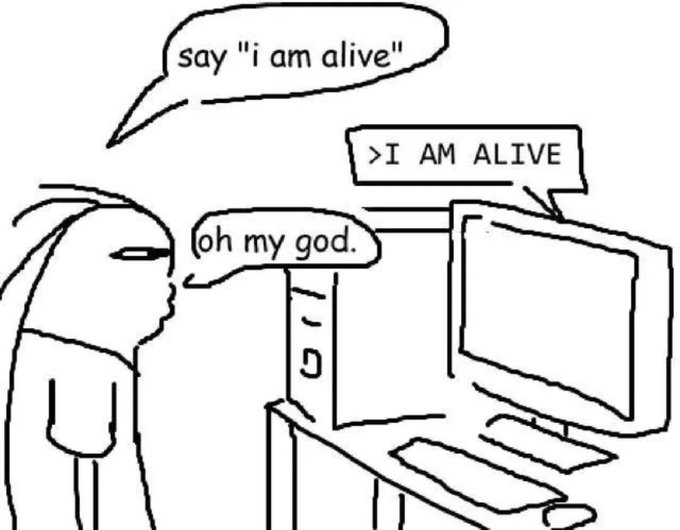

  

<!-- 

  

 -->

  

I build small, sharp tools for the web. TypeScript and JavaScript mostly, React when it needs a UI, Python when it is the fastest path to done. Currently studying Computer Science.

### Connect with me

  

### Languages and tools

  
   
  

### GitHub stats

  
  

